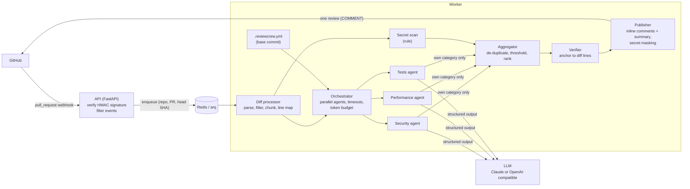

# ReviewCrew

A multi-agent pull request reviewer that runs as a GitHub App. When a pull request is opened
or updated, three specialist agents (security, performance and tests) review the diff in
parallel. Their findings are merged, checked against the diff and posted back as a single
review: inline comments on the affected lines plus a summary.

## Demo

Real output, copied verbatim from a live pull request reviewed by a local
`qwen2.5-coder:7b` (Ollama) — nothing edited. The PR adds a `login` function to
`app/auth.py` with a hardcoded database password (line 3) and a SQL query built by string
concatenation (line 8). The comments below do not repeat the password; in the third comment
of that review (a test suggestion) the model did quote it, and ReviewCrew masked it before
posting.
(Review of commit `65cc20a` in a private test repository, posted on 2026-10-17.)

**Summary comment**

> ## 🛡️ ReviewCrew review
>
> | Agent | Findings | Highest severity | Tokens | Time | Status |
> |---|---:|---|---:|---:|---|
> | 🔒 Security | 2 | high | 1,612 | 24.9s | ✅ |
> | ⚡ Performance | 0 | — | 1,554 | 35.5s | ✅ |
> | 🧪 Tests | 1 | high | 1,892 | 58.1s | ✅ |
> | 🔑 Secret scan (rule) | 0 (1 raw) | — | — | — | ✅ |
>
> **3 findings**: 3 inline.
> <sub>1 finding outside the reporting agent's area dropped · 1 duplicate merged</sub>
>
> <sub>Reviewed 1 of 1 files in 1 chunk · 5,058 tokens · 59.7s total · commit 65cc20a · automated suggestions, please verify.</sub>

**Inline comment on `app/auth.py`, line 3**

> **🔒 Security · High** · confidence 1.00
>
> **Hardcoded Secret**
>
> The database password is hardcoded in the code, which makes it easy for an attacker to discover and use it.
>
> **Suggested fix**
>
> Remove the hardcoded password and store it securely, such as in an environment variable or a secure vault.

**Inline comment on `app/auth.py`, line 8**

> **🔒 Security · High** · confidence 1.00
>
> **SQL Injection Vulnerability**
>
> The SQL query is constructed using string concatenation, which allows an attacker to inject malicious SQL code through the `username` or `password` parameters.
>
> **Suggested fix**
>
> Use parameterized queries to prevent SQL injection. Here is an example of how to fix it:
>
> ```python
> query = "SELECT * FROM users WHERE name = ? AND password = ?"
> cur.execute(query, (username, password))
> ```

## What it does

- **Three reviewers in parallel.** Security (injection, secrets, auth, XSS, unsafe
  deserialization, ...), performance (N+1 queries, unbounded work, blocking I/O, ...) and
  tests (untested logic, missing edge cases, tests that cannot fail). Each has its own prompt
  and returns typed, schema-validated findings.
- **Deterministic where it can be.** A rule-based secret scan reports hardcoded credentials
  on their exact line, independent of the model. Every LLM finding states its category, and
  the performance and test reviewers' findings outside their area are dropped in code
  rather than by asking nicely in the prompt. The test reviewer is told which changed
  functions no test file in the PR mentions.
- **One clean review.** Duplicates across agents are merged, low-confidence findings are
  hidden, and every comment is anchored to a line GitHub accepts. Findings outside the
  changed lines go to the summary instead of being dropped.
- **Safe by construction.** It only reads code and never runs it, posts plain comments
  (never approves or requests changes), treats PR content as untrusted data, and masks secret
  values in its own comments.
- **Built for real repositories.** Lock files, minified, generated and binary files are
  skipped; large diffs are split into token-bounded chunks; a per-PR token budget caps cost;
  each commit is reviewed once, even when GitHub redelivers the webhook.
- **Configurable per repository** with an optional `.reviewcrew.yml`.

The orchestration is plain `asyncio`, without an agent framework.

## Architecture



| Path | Responsibility |
|---|---|
| `src/reviewcrew/webhook/` | Signature verification (`X-Hub-Signature-256`, constant-time) and event filtering |
| `src/reviewcrew/github/` | App JWT, cached installation tokens, REST client |
| `src/reviewcrew/diff/` | `unidiff` parsing, filters, context expansion, chunking, line map, changed-function detection |
| `src/reviewcrew/rules/` | Deterministic checks (secret scan) reported next to the agents |
| `src/reviewcrew/llm/` | Provider-agnostic structured completions (Anthropic, OpenAI-compatible), retries |
| `src/reviewcrew/agents/` | The three agents and their prompts |
| `src/reviewcrew/pipeline/` | Orchestrator, token budget, aggregator, verifier, publisher |
| `src/reviewcrew/repo_config/` | `.reviewcrew.yml` schema and loader |
| `src/reviewcrew/jobs.py`, `worker.py` | Queue, per-commit idempotency, arq worker |
| `eval/` | Evaluation cases and runner |

## Quick start (Docker)

You need Docker, a GitHub App and an LLM. The default is a free local model through
[Ollama](https://ollama.com) ([docs/local-llm.md](docs/local-llm.md)); Anthropic's Claude API
is an optional alternative.

1. **Create the GitHub App** and install it on a test repository:
   [docs/github-app-setup.md](docs/github-app-setup.md) (about 10 minutes). Minimum
   permissions: *Pull requests* read & write, *Contents* read, *Metadata* read; event:
   *Pull request*.
2. **Configure:**

   ```bash
   cp .env.example .env
   ```

   Set `GITHUB_APP_CLIENT_ID`, `GITHUB_PRIVATE_KEY_PATH` (the downloaded `.pem`, outside the
   repository) and `GITHUB_WEBHOOK_SECRET`. The LLM settings already point at Ollama
   (`qwen2.5-coder:7b`); for Claude set `LLM_PROVIDER=anthropic` and `ANTHROPIC_API_KEY`.
3. **Run** the API, the worker and Redis:

   ```bash
   docker compose up --build
   ```

4. **Expose the webhook** to GitHub. For local testing, forward it with
   [smee.io](https://smee.io):

   ```bash
   npx smee-client --url https://smee.io/<channel> --target http://127.0.0.1:8000/webhook
   ```

5. Open a pull request in the test repository. The review appears within a minute or two.

The image is multi-stage and runs as an unprivileged user; the private key is mounted as a
Docker secret rather than baked into the image or passed as an environment variable.

## Configuration

Per repository, commit a `.reviewcrew.yml` to the default branch (all keys optional):

```yaml
agents: [security, performance, tests]
min_severity: medium       # hide low-severity findings
ignore: ["docs/**", "*.snap", "legacy/"]
max_comments: 15           # inline comments per PR; the rest go to the summary
language: en               # en | tr
```

It is read from the pull request's **base** commit, so a PR cannot switch off the reviewers
that would flag it. An invalid file falls back to defaults and the summary says why. Details:
[docs/configuration.md](docs/configuration.md).

Server-side settings (model, effort, token budget, confidence threshold, timeouts, ...) are
environment variables; see [.env.example](.env.example). Two providers are supported:
any OpenAI-compatible endpoint (`LLM_PROVIDER=openai_compat`, e.g. a local Ollama, the
default in `.env.example`) and Anthropic's Claude API (`LLM_PROVIDER=anthropic`, default
model `claude-opus-5-5`). Both use structured output with the same JSON schema.

## Evaluation

`eval/cases/` holds 26 small pull requests with known answers: 21 contain deliberate
problems (10 security, 7 performance, 5 missing or ineffective tests; one case has two)
and 5 are clean, to measure false positives. Each case is a `before/` and `after/` tree
plus a `case.yml` naming the expected findings by category, file and line. The prompts were
tuned on this set. `eval/cases_holdout/` holds 8 more cases (2 per agent, 2 clean, in
patterns and languages the tuning set does not use) that were written and committed before
the prompts were frozen and never used for tuning.

```bash
uv run python -m eval.run                       # one run, writes eval/results.md
uv run python -m eval.run --repeat 3            # mean (min-max) over three runs
uv run python -m eval.run --cases eval/cases_holdout --output eval/results_holdout.md
uv run python -m eval.run --update-readme       # also refreshes the table below
```

A finding counts as correct when it has the expected category and file and lies within
two lines of the expected location. The runner uses the same LLM and review settings as
the bot and calls the real model (free with a local model, paid with a hosted API). The
agent rows measure the LLM alone; the deterministic secret scan is scored on its own row,
so a rule hit never hides a model miss.

**Setup of the numbers below:** `qwen2.5-coder:7b` (Q4_K_M) on Ollama 0.40.5, 16k context,
temperature 0; about 70% of the model on an RTX 4050 Laptop GPU (6 GB), the rest on the CPU.
Each set was run 3 times with the frozen prompts (commit `a65b45f`); cells show the mean
and, where the runs differed, the min-max range. Full reports:
[eval/results.md](eval/results.md), [eval/results_holdout.md](eval/results_holdout.md).

### Tuning set (26 cases)

<!-- eval-results:start -->
Model `qwen2.5-coder:7b` (OpenAI-compatible endpoint (local), min confidence 0.5, chunks up to 4000 tokens) · 26 cases, 5 of them clean · 3 runs, mean (min-max) · 2026-10-16

| Agent | Expected | Reported | TP | FP | FN | Precision | Recall | F1 |
|---|---:|---:|---:|---:|---:|---:|---:|---:|
| security | 10 | 20.3 (19-21) | 10 | 10.3 (9-11) | 0 | 49% (48%-53%) | 100% | 66% (65%-69%) |
| performance | 7 | 16 (15-17) | 7 | 9 (8-10) | 0 | 44% (41%-47%) | 100% | 61% (58%-64%) |
| tests | 5 | 9 | 5 | 4 | 0 | 56% | 100% | 71% |
| **all LLM agents** | 22 | 45.3 (44-47) | 22 | 23.3 (22-25) | 0 | 49% (47%-50%) | 100% | 65% (64%-67%) |
| secret scan (rule) | — | 1 | 1 | 0 | — | 100% | — | — |

| Per case | Mean |
|---|---:|
| Tokens | 4,882 |
| Cost (list price) | n/a (local or unpriced model) |
| Duration (agents in parallel) | 53.3s |

False positives on the 5 clean cases per run: 8.3 (8-9) from the LLM agents, 0 from the secret scan.
<!-- eval-results:end -->

**Before and after tuning.** The tuning after the first live review (secret scan, enforced
finding categories, coverage hints for the test reviewer) did not move the aggregate
numbers. It fixed failure modes seen on a real PR (a missed hardcoded password, the
performance and test reviewers repeating the security finding) and, along the way, test
findings anchored at the test file instead of the function. One intermediate version made
things worse and was reverted; every run is kept in [eval/history/](eval/history/README.md).

| All LLM agents, tuning set | Baseline (`ad63b60`, 1 run) | Final (`a65b45f`, 3 runs) |
|---|---:|---:|
| Precision | 48% | 49% (47%-50%) |
| Recall | 100% | 100% |
| F1 | 65% | 65% (64%-67%) |
| False positives on clean cases | 8 | 8.3 (8-9) |
| Tests agent precision / recall | 56% / 100% | 56% / 100% |

### Held-out set (8 cases, never used for tuning)

| Agent | Expected | Reported | TP | FP | FN | Precision | Recall | F1 |
|---|---:|---:|---:|---:|---:|---:|---:|---:|
| security | 2 | 6 | 2 | 4 | 0 | 33% | 100% | 50% |
| performance | 2 | 5.3 (5-6) | 2 | 3.3 (3-4) | 0 | 38% (33%-40%) | 100% | 55% (50%-57%) |
| tests | 2 | 5 | 2 | 3 | 0 | 40% | 100% | 57% |
| **all LLM agents** | 6 | 16.3 (16-17) | 6 | 10.3 (10-11) | 0 | 37% (35%-38%) | 100% | 54% (52%-55%) |

False positives on the 2 clean cases per run: 4 from the LLM agents, 0 from the secret scan
(no held-out case contains a secret).

### What the numbers say

- **Recall is high, precision is low.** With a 7B model, roughly every second finding on
  the tuning set is wrong, and almost two of three on the held-out set. Precision does not
  carry over from the tuning set (49% to 37%), recall does (100% on both). Every case has a
  single, deliberate problem, so 100% recall here is an optimistic upper bound.
- **Clean code still gets comments**: about 8 false positives over 5 clean cases per run,
  and 4 over 2 clean held-out cases. The test reviewer flags small helpers as untested; the
  security and performance reviewers flag harmless constants and assignments.
- **Test findings can land on the wrong line.** For functions that the PR's own tests
  already call, the test reviewer tended to report a missing case at the test file instead
  of the function. A note in its prompt fixed this on the evaluation, but it depends on a
  small model following that note.
- **Runs vary**, mostly in the number of false positives (see the ranges). An aborted
  held-out attempt, interrupted when the machine went to sleep, missed the `list.pop(0)`
  case in its one complete run; after restarting Ollama all three final runs found it.
- **Small sets:** 22 + 6 expected findings. One finding moves a held-out precision by
  several points. Treat the numbers as a regression check, not a benchmark.

## Security

- **Webhook authentication:** every delivery's HMAC-SHA256 signature is verified with a
  constant-time comparison before anything else; invalid requests get `401`.
- **No code execution:** the bot reads diffs and file contents through the GitHub API and
  never checks out, builds or runs pull request code.
- **Prompt injection:** PR content (diff, title, file names) is placed between random,
  per-request markers and the system prompt states that it is data, not instructions. The
  model can only return schema-validated findings, and the bot only ever posts `COMMENT`
  reviews, so an injected "approve this" has nothing to act on.
- **Secrets:** candidate secrets on added lines are masked in every comment the bot writes,
  even if the model repeats them. Logs never contain tokens, keys or diff contents, and
  provider error details stay in the logs rather than in public comments.
- **Least privilege:** the GitHub App needs only *Pull requests* (read & write),
  *Contents* (read) and *Metadata* (read).
- **Configuration from the base branch:** a PR cannot weaken its own review via
  `.reviewcrew.yml`.

## Limitations

- **LLM judgement.** Findings can be wrong or miss real problems; the summary labels them
  as automated suggestions. With the default local 7B model about half of the findings are
  false positives (see [Evaluation](#evaluation)); larger hosted models should do better,
  but that has not been measured here. The evaluation uses small, hand-written cases,
  which is no substitute for measuring on real pull requests.
- **Diff-centric context.** Agents see the diff plus a few surrounding lines, not the whole
  repository, so issues that depend on distant code (callers, configuration) can be missed.
- **Duplicate detection is lexical.** The same issue described in completely different
  words by two agents may appear twice.
- **Heuristic helpers.** The secret scan matches known token formats and credential-like
  names, so it can miss unusual secrets or flag test fixtures. The untested-function hint is
  regex based (Python, JS/TS, Go, class declarations) and only knows about tests in the same
  pull request.
- **Very large pull requests** are limited by the token budget, and GitHub may refuse to
  return a diff for extremely large ones.
- **GitHub only**, and one review per commit: re-reviewing the same commit needs a new push.
- **Summary language.** With `language: tr` the findings are written in Turkish, but the
  summary's fixed headings stay in English.

## Development

Requires [uv](https://docs.astral.sh/uv/) (it installs Python 3.12 for you).

```bash
uv sync
uv run ruff check . && uv run ruff format --check . && uv run mypy && uv run pytest
uv run pytest -m live          # optional: agents against the real LLM (costs money)

# Without Docker: Redis, then the API and the worker in separate terminals
docker run -d -p 127.0.0.1:6379:6379 redis:8.10-alpine
uv run reviewcrew
uv run reviewcrew-worker
```

Tests mock GitHub and the LLM (`respx`, `httpx2.MockTransport`, `fakeredis`), so the suite
runs offline. See [CONTRIBUTING.md](CONTRIBUTING.md).

## License

[MIT](LICENSE)
