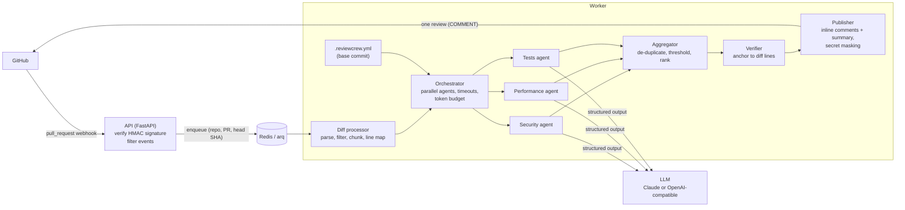

# ReviewCrew

A multi-agent pull request reviewer that runs as a GitHub App. When a pull request is opened
or updated, three specialist agents (security, performance and tests) review the diff in
parallel. Their findings are merged, checked against the diff and posted back as a single
review: inline comments on the affected lines plus a summary.

<!-- Demo: add a screenshot or GIF of a review here, for example
 -->

## What it does

- **Three reviewers in parallel.** Security (injection, secrets, auth, XSS, unsafe
  deserialization, ...), performance (N+1 queries, unbounded work, blocking I/O, ...) and
  tests (untested logic, missing edge cases, tests that cannot fail). Each has its own prompt
  and returns typed, schema-validated findings.
- **One clean review.** Duplicates across agents are merged, low-confidence findings are
  hidden, and every comment is anchored to a line GitHub accepts. Findings outside the
  changed lines go to the summary instead of being dropped.
- **Safe by construction.** It only reads code and never runs it, posts plain comments
  (never approves or requests changes), treats PR content as untrusted data, and masks secret
  values in its own comments.
- **Built for real repositories.** Lock files, minified, generated and binary files are
  skipped; large diffs are split into token-bounded chunks; a per-PR token budget caps cost;
  each commit is reviewed once, even when GitHub redelivers the webhook.
- **Configurable per repository** with an optional `.reviewcrew.yml`.

The orchestration is plain `asyncio`, without an agent framework.

## Architecture



| Path | Responsibility |
|---|---|
| `src/reviewcrew/webhook/` | Signature verification (`X-Hub-Signature-256`, constant-time) and event filtering |
| `src/reviewcrew/github/` | App JWT, cached installation tokens, REST client |
| `src/reviewcrew/diff/` | `unidiff` parsing, filters, context expansion, chunking, line map |
| `src/reviewcrew/llm/` | Provider-agnostic structured completions (Anthropic, OpenAI-compatible), retries |
| `src/reviewcrew/agents/` | The three agents and their prompts |
| `src/reviewcrew/pipeline/` | Orchestrator, token budget, aggregator, verifier, publisher |
| `src/reviewcrew/repo_config/` | `.reviewcrew.yml` schema and loader |
| `src/reviewcrew/jobs.py`, `worker.py` | Queue, per-commit idempotency, arq worker |
| `eval/` | Evaluation cases and runner |

## Quick start (Docker)

You need Docker, a GitHub App and an LLM. The default is a free local model through
[Ollama](https://ollama.com) ([docs/local-llm.md](docs/local-llm.md)); Anthropic's Claude API
is an optional alternative.

1. **Create the GitHub App** and install it on a test repository:
   [docs/github-app-setup.md](docs/github-app-setup.md) (about 10 minutes). Minimum
   permissions: *Pull requests* read & write, *Contents* read, *Metadata* read; event:
   *Pull request*.
2. **Configure:**

   ```bash
   cp .env.example .env
   ```

   Set `GITHUB_APP_CLIENT_ID`, `GITHUB_PRIVATE_KEY_PATH` (the downloaded `.pem`, outside the
   repository) and `GITHUB_WEBHOOK_SECRET`. The LLM settings already point at Ollama
   (`qwen2.5-coder:7b`); for Claude set `LLM_PROVIDER=anthropic` and `ANTHROPIC_API_KEY`.
3. **Run** the API, the worker and Redis:

   ```bash
   docker compose up --build
   ```

4. **Expose the webhook** to GitHub. For local testing, forward it with
   [smee.io](https://smee.io):

   ```bash
   npx smee-client --url https://smee.io/<channel> --target http://127.0.0.1:8000/webhook
   ```

5. Open a pull request in the test repository. The review appears within a minute or two.

The image is multi-stage and runs as an unprivileged user; the private key is mounted as a
Docker secret rather than baked into the image or passed as an environment variable.

## Configuration

Per repository, commit a `.reviewcrew.yml` to the default branch (all keys optional):

```yaml
agents: [security, performance, tests]
min_severity: medium       # hide low-severity findings
ignore: ["docs/**", "*.snap", "legacy/"]
max_comments: 15           # inline comments per PR; the rest go to the summary
language: en               # en | tr
```

It is read from the pull request's **base** commit, so a PR cannot switch off the reviewers
that would flag it. An invalid file falls back to defaults and the summary says why. Details:
[docs/configuration.md](docs/configuration.md).

Server-side settings (model, effort, token budget, confidence threshold, timeouts, ...) are
environment variables; see [.env.example](.env.example). Two providers are supported:
any OpenAI-compatible endpoint (`LLM_PROVIDER=openai_compat`, e.g. a local Ollama, the
default in `.env.example`) and Anthropic's Claude API (`LLM_PROVIDER=anthropic`, default
model `claude-opus-5-5`). Both use structured output with the same JSON schema.

## Evaluation

`eval/cases/` holds 26 small pull requests with known answers: 21 contain deliberate
problems (10 security, 7 performance, 5 missing or ineffective tests; one case has two)
and 5 are clean, to measure false positives. Each case is a `before/` and `after/` tree
plus a `case.yml` naming the expected findings by category, file and line.

```bash
uv run python -m eval.run                  # writes eval/results.md
uv run python -m eval.run --update-readme  # also refreshes the table below
```

A finding counts as correct when it has the expected category and file and lies within
two lines of the expected location. The runner uses the same LLM and review settings as
the bot and calls the real model (free with a local model, paid with a hosted API). The
report states the model and provider that produced the numbers.

<!-- eval-results:start -->
*Not run against a real model yet.* Run the command above with an API key configured to
fill in this table.
<!-- eval-results:end -->

## Security

- **Webhook authentication:** every delivery's HMAC-SHA256 signature is verified with a
  constant-time comparison before anything else; invalid requests get `401`.
- **No code execution:** the bot reads diffs and file contents through the GitHub API and
  never checks out, builds or runs pull request code.
- **Prompt injection:** PR content (diff, title, file names) is placed between random,
  per-request markers and the system prompt states that it is data, not instructions. The
  model can only return schema-validated findings, and the bot only ever posts `COMMENT`
  reviews, so an injected "approve this" has nothing to act on.
- **Secrets:** candidate secrets on added lines are masked in every comment the bot writes,
  even if the model repeats them. Logs never contain tokens, keys or diff contents, and
  provider error details stay in the logs rather than in public comments.
- **Least privilege:** the GitHub App needs only *Pull requests* (read & write),
  *Contents* (read) and *Metadata* (read).
- **Configuration from the base branch:** a PR cannot weaken its own review via
  `.reviewcrew.yml`.

## Limitations

- **LLM judgement.** Findings can be wrong or miss real problems; the summary labels them
  as automated suggestions. Small local models are noticeably weaker than large hosted
  ones; the evaluation shows by how much on your setup. The evaluation measures this on a small, hand-written case set,
  which is no substitute for measuring on real pull requests.
- **Diff-centric context.** Agents see the diff plus a few surrounding lines, not the whole
  repository, so issues that depend on distant code (callers, configuration) can be missed.
- **Duplicate detection is lexical.** The same issue described in completely different
  words by two agents may appear twice.
- **Very large pull requests** are limited by the token budget, and GitHub may refuse to
  return a diff for extremely large ones.
- **GitHub only**, and one review per commit: re-reviewing the same commit needs a new push.
- **Summary language.** With `language: tr` the findings are written in Turkish, but the
  summary's fixed headings stay in English.

## Development

Requires [uv](https://docs.astral.sh/uv/) (it installs Python 3.12 for you).

```bash
uv sync
uv run ruff check . && uv run ruff format --check . && uv run mypy && uv run pytest
uv run pytest -m live          # optional: agents against the real LLM (costs money)

# Without Docker: Redis, then the API and the worker in separate terminals
docker run -d -p 6379:6379 redis:8.10-alpine
uv run reviewcrew
uv run reviewcrew-worker
```

Tests mock GitHub and the LLM (`respx`, `httpx2.MockTransport`, `fakeredis`), so the suite
runs offline. See [CONTRIBUTING.md](CONTRIBUTING.md).

## License

[MIT](LICENSE)
